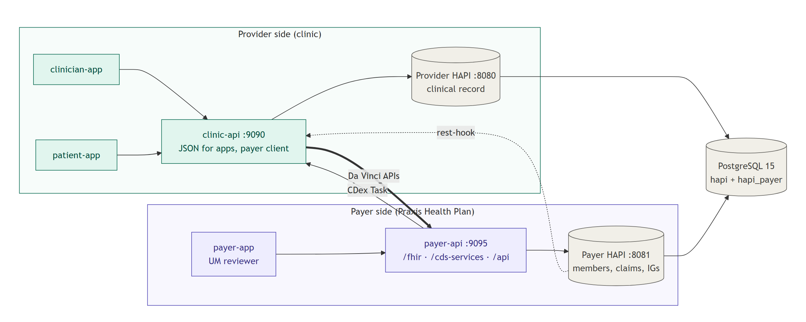
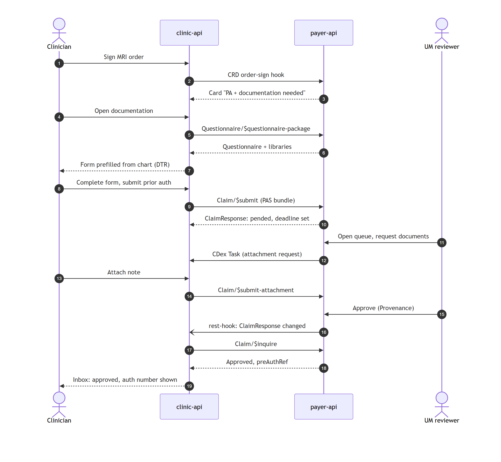
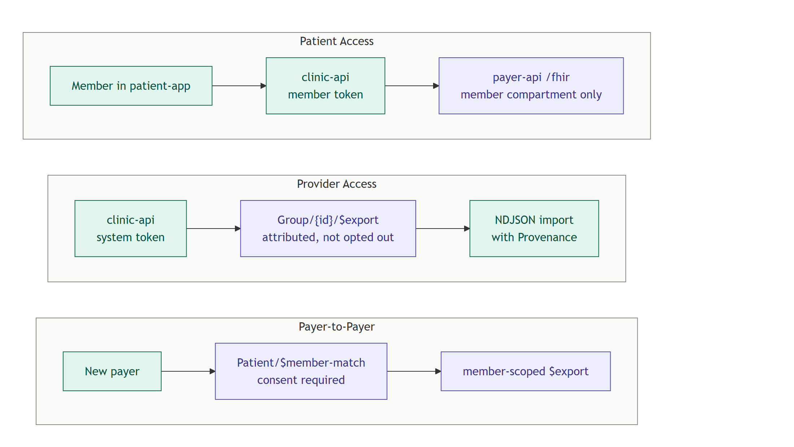

# Payer architecture

How the payer side (a fictional health plan, **Praxis Health Plan**) sits next to the existing clinic, and how the two talk through the Da Vinci IGs. For the goal and backlog, see the [roadmap](roadmap/payer-davinci.md). Decisions and their trade-offs are in [`docs/adr/`](adr/).

## 1. The two sides



| Layer | Provider side (exists) | Payer side (new) |
|---|---|---|
| UI | clinician-app, patient-app | payer-app: utilization management (UM) reviewer |
| API | clinic-api :9090: JSON for its apps, and the **client** of the payer's Da Vinci APIs | payer-api :9095: `/fhir` interop **server**, `/cds-services` (CRD), `/oauth/token`, `/api` JSON for payer-app |
| FHIR store | provider HAPI :8080 (database `hapi`) | payer HAPI :8081 (database `hapi_payer`, IG packages loaded) |
| Storage | one PostgreSQL 15 container | |

The two sides share nothing but HTTP. A patient in the clinic and a member at the payer are different FHIR resources in different servers, linked by the member id on `Coverage`. This mirrors real life and is why Payer-to-Payer needs `$member-match` ([ADR 0001](adr/0001-separate-payer-service.md)).

## 2. Who calls whom

| From → to | Call | IG |
|---|---|---|
| clinic-api → payer-api | `POST /cds-services/{hook}` on order sign and appointment book | CRD |
| clinic-api → payer-api | `Questionnaire/$questionnaire-package` | DTR |
| clinic-api → payer-api | `Claim/$submit`, `Claim/$inquire` | PAS |
| payer HAPI → clinic-api | rest-hook on `ClaimResponse` change (shared secret) | PAS notification |
| payer-api → clinic-api | `POST /fhir/Task` (attachment request) | CDex |
| clinic-api → payer-api | `Claim/$submit-attachment` | CDex |
| clinic-api → payer-api | Patient Access reads (member token), `Group/{id}/$export` (Provider Access) | PDex, ATR |
| other payer → payer-api | `Patient/$member-match`, then a member-scoped `$export` | PDex, HRex |
| anyone → payer-api | Plan-Net and Formulary search, no auth | Plan-Net, Formulary |

### Prior auth sequence



### PDex flows



## 3. Inside payer-api

```
payer-api/src/main/java/.../payer/
  interop/     HAPI RestfulServer + resource/operation providers: FHIR in, FHIR out
  cdshooks/    CRD discovery and hook handlers (CDS Hooks JSON with FHIR resources inside)
  controller/  JSON endpoints for payer-app (DTOs only)
  service/     business logic: CoverageRuleService, Adjudicator, SlaClock, MemberService, …
  mapper/      FHIR ↔ DTO
  dto/         Java records
  security/    staff roles, SMART scopes, ScopeInterceptor, member compartment
  config/      FhirConfig (payer HAPI client), RestfulServerConfig, SecurityConfig
```

Rules enforced by ArchUnit ([ADR 0002](adr/0002-fhir-at-the-payer-boundary.md)):

- `org.hl7.fhir.*` types are allowed in `interop`, `cdshooks`, `mapper` and `service`, and never in `controller` or `dto`.
- Data access goes through the payer HAPI via the shared `IGenericClient`. Nothing talks to Postgres directly.

clinic-api gets two additions:

- A `client` package with `CrdClient`, `DtrClient`, `PasClient`, `CdexClient` and `PdexClient`, each calling payer-api. Calls are wrapped by services, and controllers still see DTOs only.
- An `interop` package with one inbound FHIR endpoint, `POST /fhir/Task`, for CDex attachment requests, authenticated with a payer system token.

## 4. What we reuse instead of building

| Need | Reused |
|---|---|
| Bulk export for Provider Access and Payer-to-Payer | HAPI JPA `$export` (`hapi.fhir.bulk_export_enabled`). payer-api only authorizes the request and proxies it. |
| Profile validation | HAPI `$validate` against the IG packages loaded into the payer HAPI; the HL7 validator CLI in CI |
| Decision notifications | rest-hook `Subscription`, the same pattern as the high BP alerts (`HighBpAlertService`, `AlertController`) |
| Auth | clinic-api's `JwtConfig`, `TokenService` and `RolePermissions` patterns; `libs/auth` in payer-app |
| Seeding and e2e | `apps/seed-demo-data`, `libs/e2e-support` |

## 5. Implementation guides

The payer HAPI (`hapi-fhir-payer` in `infra/docker-compose.yml`) installs these packages at startup with `installMode: STORE_AND_INSTALL`. Versions were checked on packages.fhir.org on 2026-11-07, and all of them are FHIR R4.

| Package | Version | Note |
|---|---|---|
| hl7.fhir.us.core | 7.0.0 | 9.0.0 is the latest, but every Da Vinci IG below is built on 7.0.0 |
| hl7.fhir.us.davinci-hrex | 1.2.0 | |
| hl7.fhir.us.davinci-crd | 2.2.1 | |
| hl7.fhir.us.davinci-dtr | 2.2.0 | the registry's 3.0.1 is an STU3 package |
| hl7.fhir.us.davinci-pas | 2.2.1 | |
| hl7.fhir.us.davinci-cdex | 2.1.0 | |
| hl7.fhir.us.davinci-pdex | 2.2.0 | |
| hl7.fhir.us.carin-bb | 2.2.0 | |
| hl7.fhir.us.davinci-pdex-plan-net | 1.2.0 | |
| hl7.fhir.us.davinci-drug-formulary | 2.1.0 | |
| hl7.fhir.us.davinci-atr | 2.1.0 | |
| hl7.terminology.r4 | 7.1.0 | shared dependency |
| hl7.fhir.uv.extensions.r4 | 5.2.0 | shared dependency |

How the packages are loaded:

- `install_transitive_ig_dependencies` is off. Some IGs depend on older releases of each other (CDex 2.1.0 on PAS 2.1.0, ATR and Formulary on HRex 1.1.0), so transitive installs would load two versions of the same profiles, along with VSAC and the US Core 3.1.1 and 6.1.0 packages. Only the packages above are installed.
- HAPI 7.4.0 stores only `active` conformance resources as REST resources. Draft ones (for example the CRD hook contexts, `PASTempCodes`, `hrex-patient-demographics` and `hrex-consent`) are not searchable, but they stay in the package cache and `$validate` still uses them.
- Each start reinstalls the packages, so the payer HAPI takes about 4 to 5 minutes to become healthy. The compose healthcheck allows 10 minutes.
- Bulk export (`$export`), rest-hook subscriptions and request validation are on. Requests that fail validation get a 422 with an `OperationOutcome`.

`bash infra/payer/smoke.sh` checks that one profile per IG (the PAS Claim profile first) resolves to exactly one `StructureDefinition`, and that `$export` is in the CapabilityStatement. `PAYER_FHIR_URL` and `WAIT_SECONDS` override the defaults.

## 6. Coverage rules

`payer-api/src/main/resources/coverage-rules.yaml` is the one rules source for CRD, DTR and PAS ([ADR 0007](adr/0007-one-coverage-rules-source.md)). `CoverageRuleService` loads it at startup and refuses to start on an invalid file. Lookups are by code system + code, and an unknown code means "no PA needed". These codes are the canonical ones for the §5 demo orders, seeds and fixtures.

| Service | System | Code | PA | Docs | Questionnaire |
|---|---|---|---|---|---|
| CBC | `http://loinc.org` | `58410-2` | no | no | |
| Thyroid panel (free T4 + TSH) | `http://loinc.org` | `24348-5` | no | no | |
| Continuous glucose monitor | `http://www.cms.gov/Medicare/Coding/HCPCSReleaseCodeSets` | `E2103` | yes | yes | `continuous-glucose-monitor` |
| Polysomnography | `http://snomed.info/sct` | `60554003` | yes | yes | `polysomnography` |
| Echocardiogram | `http://snomed.info/sct` | `40701008` | yes | yes | `echocardiogram` |
| MRI lumbar spine without contrast | `http://www.ama-assn.org/go/cpt` | `72148` | yes | yes | `mri-lumbar-spine` |
| Cardiac stress test | `http://snomed.info/sct` | `76746007` | yes | no | |
| Emergency cardiac workup | `http://snomed.info/sct` | `276341003` | yes, waived when `stat` | no | |

- Questionnaire canonicals are `http://praxishealthplan.example/fhir/Questionnaire/<name>`; E3-S1 authors them.
- `emergencyExempt` waives PA for `stat` orders only. An `urgent` order still needs PA, on the expedited clock.
- `autoApproveCriteria` test DTR answers by `linkId` with `EQUALS`, `AT_LEAST` or `AT_MOST`. All met: auto-approve. An unmet criterion with a `denialReason`: deny with that reason. Otherwise, or with no criteria: pend for review. The CGM needs a diabetes diagnosis and insulin treatment; the MRI is denied under 6 weeks of conservative therapy and auto-approved only with a neurological deficit.

## 7. Out of scope

- X12 278 translation ([ADR 0004](adr/0004-fhir-pas-without-x12.md)).
- Real claims adjudication and payment. `ExplanationOfBenefit` history is seeded.
- Production-grade identity (UDAP dynamic registration, a real IdP). Tokens come from payer-api itself ([ADR 0006](adr/0006-payer-auth.md)).
