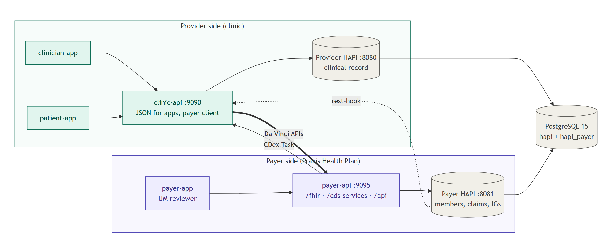
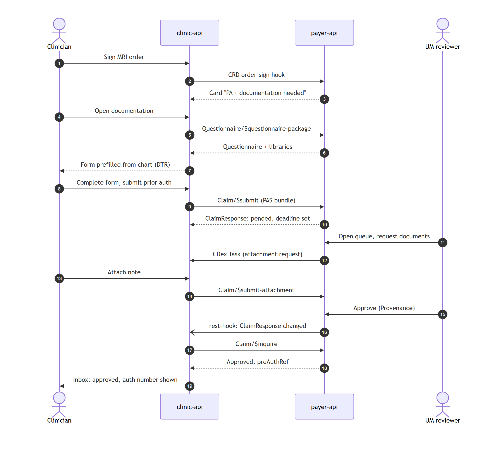
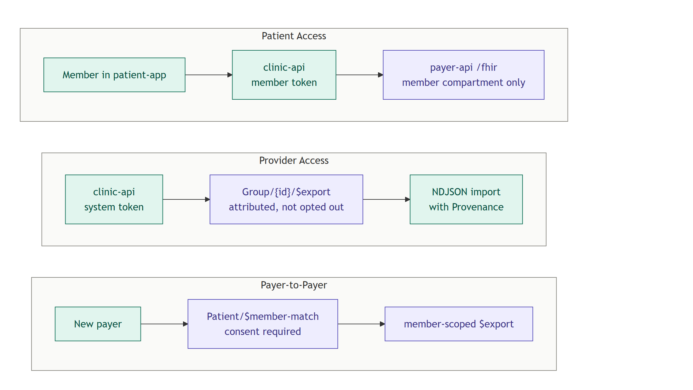

# Payer architecture

How the payer side (a fictional health plan, **Praxis Health Plan**) sits next to the existing clinic, and how the two talk through the Da Vinci IGs. For the goal and backlog, see the [roadmap](roadmap/payer-davinci.md). Decisions and their trade-offs are in [`docs/adr/`](adr/).

## 1. The two sides



| Layer | Provider side (exists) | Payer side (new) |
|---|---|---|
| UI | clinician-app, patient-app | payer-app: utilization management (UM) reviewer |
| API | clinic-api :9090: JSON for its apps, and the **client** of the payer's Da Vinci APIs | payer-api :9095: `/fhir` interop **server**, `/cds-services` (CRD), `/oauth/token`, `/api` JSON for payer-app |
| FHIR store | provider HAPI :8080 (database `hapi`) | payer HAPI :8081 (database `hapi_payer`, IG packages loaded) |
| Storage | one PostgreSQL 15 container | |

The two sides share nothing but HTTP. A patient in the clinic and a member at the payer are different FHIR resources in different servers, linked by the member id on `Coverage`. This mirrors real life and is why Payer-to-Payer needs `$member-match` ([ADR 0001](adr/0001-separate-payer-service.md)).

## 2. Who calls whom

| From → to | Call | IG |
|---|---|---|
| clinic-api → payer-api | `POST /cds-services/{hook}` on order sign and appointment book | CRD |
| clinic-api → payer-api | `Questionnaire/$questionnaire-package` | DTR |
| clinic-api → payer-api | `Claim/$submit`, `Claim/$inquire` | PAS |
| payer HAPI → clinic-api | rest-hook on `ClaimResponse` change (shared secret) | PAS notification |
| payer-api → clinic-api | `POST /fhir/Task` (attachment request) | CDex |
| clinic-api → payer-api | `Claim/$submit-attachment` | CDex |
| clinic-api → payer-api | Patient Access reads (member token), `Group/{id}/$export` (Provider Access) | PDex, ATR |
| other payer → payer-api | `Patient/$member-match`, then a member-scoped `$export` | PDex, HRex |
| anyone → payer-api | Plan-Net and Formulary search, no auth | Plan-Net, Formulary |

### Prior auth sequence



### PDex flows



## 3. Inside payer-api

```
payer-api/src/main/java/.../payer/
  interop/     HAPI RestfulServer + resource/operation providers: FHIR in, FHIR out; ScopeInterceptor
  cdshooks/    CRD discovery and hook handlers (CDS Hooks JSON with FHIR resources inside)
  controller/  JSON endpoints for payer-app (DTOs only)
  service/     business logic: CoverageRuleService, Adjudicator, SlaClock, MemberService, …
  mapper/      FHIR ↔ DTO
  dto/         Java records
  security/    staff roles and permissions, SMART scope parsing (see 15-payer-auth.md)
  config/      FhirConfig (payer HAPI client), RestfulServerConfig, SecurityConfig
```

Rules enforced by ArchUnit ([ADR 0002](adr/0002-fhir-at-the-payer-boundary.md)):

- `org.hl7.fhir.*` types are allowed in `interop`, `cdshooks`, `mapper` and `service`, and never in `controller` or `dto`.
- Data access goes through the payer HAPI via the shared `IGenericClient`. Nothing talks to Postgres directly.

clinic-api gets two additions:

- A `client` package with `CrdClient`, `DtrClient`, `PasClient`, `CdexClient` and `PdexClient`, each calling payer-api. Calls are wrapped by services, and controllers still see DTOs only.
  - `CrdClient` (built): `ServiceRequestService` and `AppointmentService` call it through `CrdService` before saving, with the draft resource, the patient's active Coverage and a filled prefetch, but only when that Coverage's payor identifier is `clinic.payer.payer-id` (no patient data goes to a payer the patient is not covered by). `PayerTokenClient` gets a `client_credentials` token from payer-api `/oauth/token` (`clinic.payer.client-id` / `client-secret`, scope `system/Coverage.r system/Questionnaire.r`) and caches it until 10 s before `expires_in`; a 401 from a hook evicts it. Both use one `RestClient` with a 2 s connect and read timeout (`clinic.payer.timeout`). Any failure fails open with a "Coverage unknown" card, and the log line has the hook, hook instance and resource ids only.
  - `DtrClient` (built): `DtrService` posts the saved order and the patient's active Coverage with this payer to `$questionnaire-package` (DTR input profile, CRD Coverage and ServiceRequest profiles, clinic-only extensions removed) and uses the first `packagebundle`. Documentation cannot be built without the Questionnaire, so a timeout, error or bad answer is not failed open: the `/api/service-requests/{id}/documentation` endpoints answer 503. The response is stored in the provider HAPI as a `dtr-questionnaireresponse` linked to the order by `qr-context` (the profile forbids `basedOn`) and to the Coverage by `qr-coverage` ([03-fhir-mapping.md](03-fhir-mapping.md#questionnaireresponse-dtr-documentation)); PAS (E4-S1) finds it the same way.
- An `interop` package with one inbound FHIR endpoint, `POST /fhir/Task`, for CDex attachment requests, authenticated with a payer system token.

### JSON endpoints for payer-app

Staff bearer token from `POST /api/auth/login` ([15-payer-auth.md](15-payer-auth.md)). Errors are `{ "status", "message" }`: 404 for an unknown member, 503 when the payer HAPI is down, 502 when it answers with an error (its diagnostics are not passed on).

| Method | Path | Permission | Returns |
|---|---|---|---|
| `GET` | `/api/members?name=&memberId=` | `member:read` | `PageResponse<MemberSummary>`: `{items, total}`, up to 100 members |
| `GET` | `/api/members/{id}` | `member:read` | `MemberResponse` |

How `MemberService` reads the payer HAPI:

| DTO field | Payer HAPI query / FHIR path |
|---|---|
| search | `Patient?identifier=http://praxishealthplan.example/fhir/identifier/member-id\|{memberId}` (system only when `memberId` is blank, so only members match), `&name={name}`, `&_revinclude=Coverage:beneficiary` |
| `id` | `Patient.id`, the path variable of the detail endpoint |
| `memberId` | `Patient.identifier[system=…/member-id].value`; a Patient without one is not a member (404) |
| `firstName`, `lastName`, `dateOfBirth`, `gender` | `Patient.name[0].given`, `.family`, `Patient.birthDate`, `Patient.gender` |
| `planName`, `coverageStatus` (search) | the current Coverage: the newest `active` one, else the newest by `period.start`; `Coverage.class[type=plan].name`, `Coverage.status` |
| `coverages[]` (detail) | `Coverage?beneficiary=Patient/{id}`, newest first: `status`, `period`, `payor[0].display`, `relationship` |
| `coverages[].plan` | `InsurancePlan?identifier=…/insurance-plan\|{Coverage.class[type=plan].value}`: `id`, `name`, `plan[0].type.text`; falls back to the Coverage class when the plan is missing |
| `priorAuths[]` (detail) | `Claim?patient=Patient/{id}&use=preauthorization&_revinclude=ClaimResponse:request&_sort=-created`: `Claim.status`, `created`, `item[0].productOrService`, and `ClaimResponse.outcome` / `preAuthRef`. `Claim/$submit` stores them. |

payer-app shows the search at `/members` (a sortable, paged `mat-table`) and the detail at `/members/:id`.

### CDS Hooks for CRD

The `cdshooks` package serves [CRD 2.2.1](https://hl7.org/fhir/us/davinci-crd/STU2.2/) over CDS Hooks. Bodies are CDS Hooks JSON with FHIR R4 resources inside; errors are an `OperationOutcome` with the HTTP status.

| Method | Path | Auth | Returns |
|---|---|---|---|
| `GET` | `/cds-services` | public | discovery: `order-sign-crd`, `order-select-crd`, `appointment-book-crd`, `encounter-start-crd` and `order-dispatch-crd`, each with `davinci-crd.version: ["2.2"]` and the prefetch templates below |
| `POST` | `/cds-services/order-sign-crd` | system token with `system/Coverage.r` | cards + `systemActions` |
| `POST` | `/cds-services/order-select-crd` | same | same, without documentation |
| `POST` | `/cds-services/appointment-book-crd` | same | same as order-sign, for each `Appointment` in `context.appointments` (code: `serviceType[0]`) |
| `POST` | `/cds-services/encounter-start-crd` | same | same as order-select (a CRD secondary hook, so no documentation), for the `encounter` prefetch, which must be `context.encounterId` (code: `type[0]`) |
| `POST` | `/cds-services/order-dispatch-crd` | same | same as order-sign, for the `ServiceRequest`s in the `dispatchedOrders` prefetch named in `context.dispatchedOrders`; the card names the performer (`context.performer`, else the `owner` of the order's Task in `context.fulfillmentTasks`). Each fulfillment Task's `focus` must be a dispatched order, and performer and owner must be references, else 400 |

| Prefetch key | Template |
|---|---|
| `patient` | `Patient/{{context.patientId}}` |
| `coverage` | `Coverage?patient={{context.patientId}}&status=active` |
| `practitioner` | `{{context.userId}}` (not on order-dispatch, which has no `userId`) |
| `encounter` | `Encounter/{{context.encounterId}}` (encounter-start only) |
| `dispatchedOrders` | `ServiceRequest?_id={{context.dispatchedOrders.ServiceRequest.id}}` (order-dispatch only) |

How a hook is answered:

1. The request needs `hook` (matching the service), `hookInstance`, `context.patientId` and a `context.draftOrders` Bundle; order-select also needs `context.selections` and answers only for the selected orders. Draft orders other than `ServiceRequest` are ignored for now.
2. The `coverage` prefetch must hold exactly one Coverage. When it is missing, payer-api runs the template against the hook's `fhirServer` with `fhirAuthorization.access_token`, but only for servers on `payer.crd.prefetch-fhir-servers` (empty by default, so hooks can't make payer-api call any URL). Otherwise the answer is 412.
3. The Coverage must name Praxis Health Plan when its `payor` carries an identifier (`payer.crd.payer-identifiers`), else 400. Its member id (`identifier[system=…/member-id]`, else `subscriberId`) is looked up in the payer HAPI (`Coverage?identifier=…`). The member is verified when one of their Coverages is `active` and its period covers today.
4. Each order's code goes to `CoverageRuleService` (§6) with the order's `priority`.

Each order, appointment or encounter gets a `systemActions` entry of type `update`: the resource with the `ext-coverage-information` extension added. The card detail names what it is about ("this order", "this appointment", "this encounter", "this order at Organization/…").

| Case | `covered` | `pa-needed` | Also | Card |
|---|---|---|---|---|
| no PA (or waived for `stat`) | `covered` | `no-auth` | | info, "Covered, no prior authorization needed: …" |
| PA, no documentation | `covered` | `auth-needed` | | warning, "Prior authorization needed: …" |
| PA + documentation (order-sign, appointment-book, order-dispatch) | `covered` | `auth-needed` | `doc-needed=clinical`, `reason`, `questionnaire` | warning, "Prior authorization needed: …" |
| member not found / no active coverage | `not-covered` | | `reason` = CRD `temp#no-member-found` / `no-active-coverage` | warning, "Coverage could not be verified" |

Every extension also has `coverage` (the client's Coverage), `date` and a `coverage-assertion-id`. Card and assertion ids are UUIDs derived from `hookInstance` and the order, so a retried hook gets the same ids.

- `doc-purpose` is left out. `withpa` is the right code, but CRD 2.2.1's invariant `crd-ci-q4` evaluates to empty, so it fails, whenever `pa-needed` is `auth-needed` and `doc-purpose` is `withpa`; the HL7 validator rejects every such extension. `doc-purpose` is optional, and the questionnaire still says which form to fill.
- CRD says coverage information SHALL travel in the `systemAction` and not as a card. We also send one Instructions card per order (topic `cdshooks-card-type#coverage-info`), because the clinician order dialog (E2-S4) shows its text. This is a deliberate deviation.
- 400 for a malformed request, no or several Coverages, or another payer; 404 for an unknown service; 412 for a missing prefetch that can't be fetched; 401/403 for a missing token or a token without `system/Coverage.r` (member tokens never qualify); 502/503 when the payer HAPI fails.
- Every hook call, including failed ones, records the `crd.hook` timer (tags `service`, `status`; Prometheus `crd_hook_seconds`) and writes an `AuditEvent` to the payer HAPI in the background: client id, `hookInstance`, HTTP outcome and the payer Coverage, no PHI.

### PAS: `Claim/$submit`

`POST /fhir/Claim/$submit` ([PAS 2.2.1](https://hl7.org/fhir/us/davinci-pas/STU2.2/), `ClaimSubmitProvider` → `ClaimSubmitService`) takes a PAS request bundle, as the `resource` parameter of a `Parameters` or as the raw body, and answers with a PAS response bundle. It needs a system token with `system/Claim.c`; member tokens get 403 (the response nests other resources, so the operation is `systemOnly`).

1. **Shape.** Exactly one Claim with `use=preauthorization`, an identifier with system and value, items, and a focal insurance whose Coverage is in the bundle. Otherwise 400.
2. **Validation.** The bundle goes to the payer HAPI's `Bundle/$validate` with `…/profile-pas-request-bundle` explicitly set on the validation copy's `meta.profile`. Any `error` or `fatal` issue gives a 422 with an `OperationOutcome` of just those issues, and nothing is stored.
3. **Idempotency (NFR-REL-1).** `Claim?identifier={system}|{value}&_revinclude=ClaimResponse:request`. If the Claim is already there, the first `ClaimResponse` is returned again and nothing new is written.
4. **Adjudication.** The member id from the Coverage (`…/member-id` identifier, else `subscriberId`) goes through `MemberCoverageService`. Then `PriorAuthAdjudicator` applies the `coverage-rules.yaml` rule for each item's `productOrService` (the first coding with a rule) to the answers of every QuestionnaireResponse in the bundle, as in §6. The order priority for `emergencyExempt` comes from the item's `extension-requestedService` order. A member who is not found or has no active coverage is denied with reason `no-member-found` / `no-active-coverage`.
5. **Storage.** One transaction on the payer HAPI: each QuestionnaireResponse, the Claim (conditional create on its identifier) and the ClaimResponse. The patient, the focal Coverage and the insurer are re-pointed at the payer's member `Patient`, `Coverage` and payor `Organization`. Other provider resources stay references to the provider's server (their `fullUrl`), or to their identifier when the bundle only gave a `urn:uuid`.
6. **Deadline (NFR-REG-1).** `SlaClock` (injected `Clock`) sets the Claim extension `http://praxishealthplan.example/fhir/StructureDefinition/decision-deadline`: 72 h when `Claim.priority` is `stat` (expedited), else 7 days. The clock runs from `Claim.created`, or from now when `created` is missing or in the future, so a backdated submission (Tony Stark, §5 of the roadmap) can be breached.
7. **Response.** `ClaimResponse` (PAS profile): `outcome=complete`, a `disposition`, and `preAuthRef` plus an identifier `…/identifier/prior-auth|PHP-PA-XXXXXXXX`, derived from the Claim identifier. Each item's adjudication has the PAS `reviewAction` with X12 306 `A1` approved (with `number` = preAuthRef), `A3` denied, `A4` pended or `NA` no PA needed. A denial also has `adjudication.reason`, a code from `…/CodeSystem/denial-reason` plus the text (NFR-REG-2). The wire copy uses the submitter's references (patient, insurer, requestor = `Claim.provider`, request = the submitted Claim). The bundle also carries the patient and both Organizations from the request.
8. **Audit (NFR-AUD-1).** Every call, including failed ones, writes an `AuditEvent` named `Claim/$submit` in the background: client id, the Claim identifier value, the HTTP outcome and the stored Claim and ClaimResponse ids.

Terminology: the payer HAPI has no CPT, HCPCS, ICD-10-CM or X12 code systems, and PAS binds claim lines (`X12278RequestedServiceType`), diagnoses and the attachment report type as required. `terminology/codesystems/` holds a `fragment` CodeSystem for each, with only the demo codes. The Plan-Net specialty bindings use the NUCC provider taxonomy, which also gets a fragment (`nucc-provider-taxonomy.json`). `payer-terminology.feature` seeds them. A CodeableConcept in a required-bound element must use one code system: HAPI rejects a SNOMED + CPT pair even though the CPT code is in the value set. PAS claim lines carry one CPT, HCPCS or X12 code, and `coverage-rules.yaml` lists the corresponding PAS codes for the clinical orders (§6).

The emergency cardiac workup has a clinical SNOMED code in the chart and no procedure billing code. PAS binds both the claim line and the linked order to the requested service type value set. Both use the X12 service classification `1365#86` for emergency services. The shared rules use the order priority to apply the emergency exemption. [PAS requested service value set](https://hl7.org/fhir/us/davinci-pas/STU2.2/ValueSet-X12278RequestedServiceType.html), [X12 service type codes](https://x12.org/codes/service-type-codes).

### Public Plan-Net directory

Payer-api serves unauthenticated FHIR read, versioned read and search at `/fhir/{resourceType}` for the [Plan-Net 1.2.0 capability statement](https://hl7.org/fhir/us/davinci-pdex-plan-net/STU1.2/CapabilityStatement-plan-net.html) types. This includes OrganizationAffiliation and the Network profile of Organization. `/fhir/metadata` lists their profiles, search fields and allowed inclusions. Other operations keep their existing SMART scope checks.

The payer HAPI stores the directory. The Plan-Net profile is the publication marker applied to the curated provider directory records. Search is restricted to those profiles, and reads and included resources are checked for the corresponding profile. The directory publishes practice details, links and contact information. Connection headers are omitted from public Endpoint representations.

The payer app reads the same published practitioner roles through its staff-only JSON `GET /api/directory?specialty=&city=`. The clinic app uses its own `GET /api/directory?patientId=&specialty=&city=`, protected by `order:write`. It resolves the chart’s active coverage with the configured payer to a unique active InsurancePlan by plan name and searches the plan’s networks. Calls to the public Plan-Net endpoint carry no patient or member identifiers. Both app APIs return provider names, specialties, practice locations and organizations.

## 4. What we reuse instead of building

| Need | Reused |
|---|---|
| Bulk export for Provider Access and Payer-to-Payer | HAPI JPA `$export` (`hapi.fhir.bulk_export_enabled`). payer-api only authorizes the request and proxies it. |
| Profile validation | HAPI `$validate` against the IG packages loaded into the payer HAPI; the HL7 validator CLI in CI |
| Decision notifications | rest-hook `Subscription`, the same pattern as the high BP alerts (`HighBpAlertService`, `AlertController`) |
| Auth | clinic-api's `JwtConfig`, `TokenService` and `RolePermissions` patterns; `libs/auth` in payer-app |
| Seeding and e2e | `apps/seed-demo-data`, `libs/e2e-support` |

## 5. Implementation guides

The payer HAPI (`hapi-fhir-payer` in `infra/docker-compose.yml`, HAPI 8.12.0; the provider HAPI stays on 7.4.0) installs these packages at startup with `installMode: STORE_AND_INSTALL`. Versions were checked on packages.fhir.org on 2026-11-07, and all of them are FHIR R4.

| Package | Version | Note |
|---|---|---|
| hl7.fhir.us.core | 7.0.0 | 9.0.0 is the latest, but every Da Vinci IG below is built on 7.0.0 |
| hl7.fhir.us.davinci-hrex | 1.2.0 | |
| hl7.fhir.us.davinci-crd | 2.2.1 | |
| hl7.fhir.us.davinci-dtr | 2.2.0 | the registry's 3.0.1 is an STU3 package |
| hl7.fhir.us.davinci-pas | 2.2.1 | |
| hl7.fhir.us.davinci-cdex | 2.1.0 | |
| hl7.fhir.us.davinci-pdex | 2.2.0 | |
| hl7.fhir.us.carin-bb | 2.2.0 | |
| hl7.fhir.us.davinci-pdex-plan-net | 1.2.0 | |
| hl7.fhir.us.davinci-drug-formulary | 2.1.0 | |
| hl7.fhir.us.davinci-atr | 2.1.0 | |
| hl7.terminology.r4 | 7.1.0 | shared dependency |
| hl7.fhir.uv.extensions.r4 | 5.3.0-ballot-tc1 | shared dependency; DTR 2.2.0 and SDC 4.0.0 need it for `questionnaire-supportHyperlink` |
| hl7.fhir.uv.sdc | 4.0.0 | profiles behind the DTR Questionnaire and Library profiles |
| hl7.fhir.uv.xver-r5.r4 | 0.1.0 | StructureDefinitions only: the SDC Questionnaire profiles slice on R5 cross-version extensions, and 10 of its ValueSets have ids over HAPI's 64-character limit (HAPI-0521) |

How the packages are loaded:

- `install_transitive_ig_dependencies` is off. Some IGs depend on older releases of each other (CDex 2.1.0 on PAS 2.1.0, ATR and Formulary on HRex 1.1.0), so transitive installs would load two versions of the same profiles, along with VSAC and the US Core 3.1.1 and 6.1.0 packages. Only the packages above are installed.
- HAPI stores only `active` conformance resources as REST resources. Draft ones (for example the CRD hook contexts, `PASTempCodes`, `hrex-patient-demographics` and `hrex-consent`) are not searchable, but they stay in the package cache and `$validate` still uses them.
- The payer HAPI runs 8.12.0 because 7.4.0's validator rejects valid PAS 2.2.1 request bundles, the IG's own `ReferralAuthorizationBundleExample` among them: the `entry:Claim` profile choice fails with bogus extension counts. For an existing 8.12.0 payer database, the terminology seed can restore missing native concepts in place.
- On a fresh database, the payer HAPI installs the packages before it serves metadata. Allow at least six minutes for a cold start. The compose healthcheck has a ten-minute start period.
- Bulk export (`$export`), rest-hook subscriptions and request validation are on. Requests that fail validation get a 422 with an `OperationOutcome`.

`bash infra/payer/smoke.sh` checks that one profile per IG (the PAS Claim profile first) resolves to exactly one `StructureDefinition`, and that `$export` is in the CapabilityStatement. `PAYER_FHIR_URL` and `WAIT_SECONDS` override the defaults.

## 6. Coverage rules

`payer-api/src/main/resources/coverage-rules.yaml` is the one rules source for CRD, DTR and PAS ([ADR 0007](adr/0007-one-coverage-rules-source.md)). `CoverageRuleService` loads it at startup and refuses to start on an invalid file. Lookups are by code system + code, and an unknown code means "no PA needed". These codes are the canonical ones for the §5 demo orders, seeds and fixtures.

| Service | System | Code | PA | Docs | Questionnaire |
|---|---|---|---|---|---|
| CBC | `http://loinc.org` | `58410-2` | no | no | |
| Thyroid panel (free T4 + TSH) | `http://loinc.org` | `24348-5` | no | no | |
| Continuous glucose monitor | `http://www.cms.gov/Medicare/Coding/HCPCSReleaseCodeSets` | `E2103` | yes | yes | `continuous-glucose-monitor` |
| Polysomnography | `http://snomed.info/sct` | `60554003` | yes | yes | `polysomnography` |
| Polysomnography (PAS claim line) | `http://www.ama-assn.org/go/cpt` | `95810` | yes | yes | `polysomnography` |
| Echocardiogram | `http://snomed.info/sct` | `40701008` | yes | yes | `echocardiogram` |
| Echocardiogram (PAS claim line) | `http://www.ama-assn.org/go/cpt` | `93306` | yes | yes | `echocardiogram` |
| MRI lumbar spine without contrast | `http://www.ama-assn.org/go/cpt` | `72148` | yes | yes | `mri-lumbar-spine` |
| Cardiac stress test | `http://snomed.info/sct` | `76746007` | yes | no | |
| Cardiac stress test (PAS claim line) | `http://www.ama-assn.org/go/cpt` | `93015` | yes | no | |
| Emergency services (PAS claim line) | `https://codesystem.x12.org/005010/1365` | `86` | yes, waived when `stat` | no | |
| Emergency cardiac workup | `http://snomed.info/sct` | `276341003` | yes, waived when `stat` | no | |

- Questionnaire canonicals are `http://praxishealthplan.example/fhir/Questionnaire/<name>`. The forms, their CQL Libraries (`Library/<name>-prepopulation`) and ValueSets are golden fixtures in `fixtures/davinci/dtr/`, seeded into the payer HAPI by `payer-questionnaires.feature`. The `autoApproveCriteria` linkIds are required items in them (`DtrQuestionnaireFixturesTest`).
- `POST /fhir/Questionnaire/$questionnaire-package` (DTR, `system/Questionnaire.r`, system tokens only) looks up each `order` code here and adds any requested `questionnaire` canonicals. Each form comes back as a `packagebundle`: the Questionnaire, an empty `in-progress` QuestionnaireResponse for the coverage and orders, then the `cqf-library` Libraries and the `answerValueSet` ValueSets from the payer HAPI. An `outcome` explains orders that need no documentation and anything missing. `changedsince` leaves out packages that haven't changed. A request with only `context` gets a 400, because looking up a saved response is not built yet.
- `emergencyExempt` waives PA for `stat` orders only. An `urgent` order still needs PA, on the expedited clock.
- `autoApproveCriteria` test DTR answers by `linkId` with `EQUALS`, `AT_LEAST` or `AT_MOST`. All met: auto-approve. An unmet criterion with a `denialReason`: deny with that reason. Otherwise, or with no criteria: pend for review. The CGM needs a diabetes diagnosis and insulin treatment; the MRI is denied under 6 weeks of conservative therapy and auto-approved only with a neurological deficit.

## 7. Out of scope

- X12 278 translation ([ADR 0004](adr/0004-fhir-pas-without-x12.md)).
- Real claims adjudication and payment. `ExplanationOfBenefit` history is seeded.
- Production-grade identity (UDAP dynamic registration, a real IdP). Tokens come from payer-api itself ([ADR 0006](adr/0006-payer-auth.md)).
